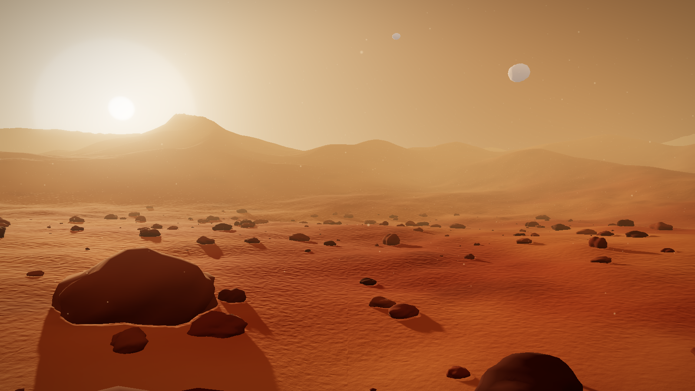

# Marte 3D

Interfaz 3D interactiva para ver la superficie de Marte en el navegador, hecha con Three.js y Vite.
Es la base de la simulación del rover Perseverance.



## Qué incluye
- Terreno rojizo procedural con relieve y textura de detalle
- Rocas con caras de fractura, unas grandes cerca de la cámara y otras dispersas
- Cielo color caramelo (shader) con halo del sol de tarde
- Luz cálida con sombras suaves y largas, niebla de polvo y partículas en suspensión
- Las dos lunas de Marte: Fobos y Deimos
- Post-procesado: tone mapping ACES y bloom

## Uso
```bash
npm install
npm run dev      # abre http://localhost:5173
npm run build    # versión para publicar, en dist/
npm run check    # abre la escena en Chrome headless y guarda check/captura.png y check/errores.txt
```

## Controles
- Arrastrar con el ratón: girar la cámara
- Rueda del ratón: zoom
